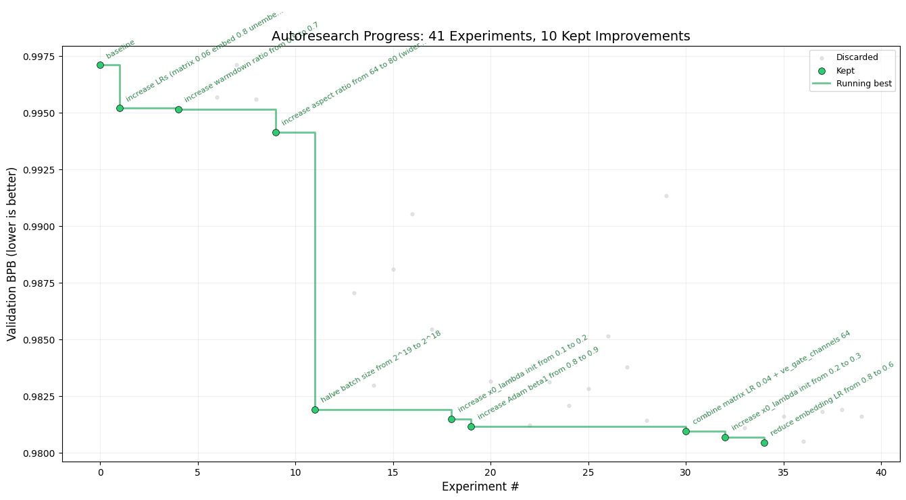
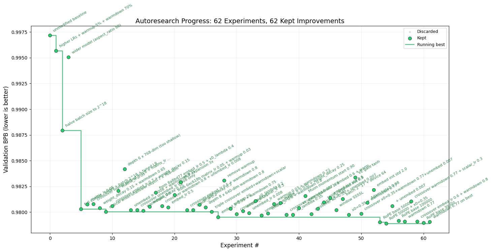

# Autoresearch Evolution

**Population-based, LLM-directed language-model research with immutable validation, 5-minute experiments, and Git-backed lineages.**

The research specification is [`program.md`](program.md), reproduced **verbatim** from the supplied document. This repo makes its protocol executable: a population of six `train.py` genomes, two elites, tournament selection, semantically directed mutation/crossover, per-candidate Git commits, a fixed `prepare.py`, checkpointing and a searchable lineage dashboard.

> **Benchmark provenance:** This repository includes an independently implemented CUDA/PyTorch Transformer baseline and a fixed ClimbMix / GPT-2-tokenizer benchmark so it is self-contained. It is *not* a copy of the original `karpathy/autoresearch` `prepare.py` and `train.py`, which use an 8,192-token trained tokenizer and different model code. Compare `val_bpb` only **within the same dataset, tokenizer, evaluator and hardware environment**. See [Benchmark protocol](docs/BENCHMARK.md).

## Quick start

**Requirements:** Linux with one NVIDIA CUDA GPU, Python 3.10+ with a compatible CUDA PyTorch build, `git`, [`uv`](https://docs.astral.sh/uv/), internet access for initial data and for the live LLM. H100 is not required for this smaller baseline; NVIDIA GPU memory requirements vary with mutation. macOS can run the orchestration tests, but this CUDA training baseline will not train on Apple GPUs. No CUDA device is available in the build environment, so the archive contains **no claimed GPU validation scores**.

```bash
# Extract the archive, then from the repository root:
uv sync
uv run prepare.py                    # download fixed shards and build token cache
uv run train.py                      # optional manual ~5-minute baseline smoke check

# Initialize a new experiment on a new autoresearch/<tag> branch.
uv run python -m autoresearch_evo init --tag nov20

export OPENAI_API_KEY="..."
export OPENAI_MODEL="your-enabled-model"
uv run python -m autoresearch_evo run --provider openai --hours 8

# After interruption, run the same command again. Already logged slots are skipped.
uv run python -m autoresearch_evo run --provider openai --hours 8
uv run python -m autoresearch_evo dashboard
# Open reports/progress.html in any browser (no server required)
```

The CLI initializes a new local Git repository with a `master` baseline commit if you extracted a ZIP. For an existing Git checkout, it requires a clean worktree and a `master` branch. Initialization refuses duplicate run tags. It does not push to GitHub or modify any remote.

**The default evolutionary loop does not pause between generations.** It ends after five unimproved generations, three majority-failure generations, a requested time/generation limit, or an interrupt. Each candidate is evaluated sequentially on a single GPU. A run may cost significant GPU time and LLM API charges. Use `--hours` to cap usage and review the provider's API billing.

## Repository map

```text
.
├── program.md                      # Exact user research specification
├── train.py                        # ONLY mutable training/evolutionary genome
├── prepare.py                      # Fixed data prep and evaluate_bpb (never mutate)
├── autoresearch_evo/
│   ├── __main__.py / cli.py        # init, run/resume, dashboard commands
│   ├── core.py                     # Git lineages, tracking, selection, checkpointing
│   ├── llm.py                      # LLM semantic mutation, crossover and repair
│   └── dashboard.py                # Standalone HTML progress and lineage visualization
├── config/evolution.json           # Population and stopping parameters
├── scripts/                         # Reproducible command helpers
├── tests/                           # Deterministic unit and end-to-end tests
├── docs/                            # Benchmark, orchestration, safety, troubleshooting
├── .github/workflows/ci.yml         # Unit tests and source validation
├── .env.example                     # Provider configuration example
├── pyproject.toml                   # Fixed runtime dependencies
├── LICENSE                          # MIT
└── .gitignore                       # Excludes live logs and generated metrics
```

## Experiment lifecycle

1. `init` checks the tokenizer/data cache and GPU, captures hardware/PyTorch/CUDA versions, creates branch `autoresearch/<tag>`, and initializes TSV headers. Use today's tag or choose a new unique one.
2. `run` evaluates the original baseline once, seeds five independent variants across conservative/moderate/radical changes, and records every candidate (including failures).
3. For each later generation, two elites carry forward without retraining. Parents are chosen by tournament, crossover is attempted at rate 0.3, and an LLM rewrites the complete `train.py` with a coherent change.
4. Each source file is Git-committed. The evaluator and data are checksum-protected. Import preflight, up to two LLM repair attempts, a 10-minute training timeout, and limited runtime repair are implemented.
5. `population.tsv` (one row per population slot), `results.tsv` (one row per evaluation), `checkpoint.txt`, `state.json`, and `summary.txt` are local, untracked files. `runs/` retains each raw log and `run.log` points to the latest log content.
6. Best-per-generation commits are tagged, and **all** variant commits are pinned under `refs/autoresearch/individuals/` even when a branch is reset to a different parent. The branch HEAD is restored to the best known evaluated candidate after a generation or shutdown.
7. A self-contained offline report at `reports/progress.html` plots best/median `val_bpb`, a clickable evolutionary lineage, and filterable candidate results.

## Configurable parameters

| Parameter | Default | Meaning |
|---|---:|---|
| `population_size` | 6 | Individuals per generation |
| `top_k` | 2 | Unchanged elites |
| `tournament_size` | 3 | Tournament candidates |
| `crossover_rate` | 0.3 | Probability of two-parent recombination |
| Mutation mix | 40% / 40% / 20% | Conservative / moderate / radical |
| Training budget | 300 s | Fixed in **prepare.py** |
| Process timeout | 600 s | Maximum elapsed run duration |
| Plateau limit | 5 generations | Stop when global best fails to improve |
| Majority failures | 3 generations | Stop after persistent catastrophic failures |

Config is snapshotted into untracked `state.json` at `init`; modify `config/evolution.json` **before** starting a new run. You can cap work with `run --max-generations 2` or `run --hours 8`.

## Greedy autoresearch vs. population-based evolution

The repository is built around the richer `program.md` protocol rather than the older `program_v1.md` protocol. The distinction matters:

| Dimension | `program_v1.md` | `program.md` / this repository |
|---|---|---|
| Search pattern | Single-lineage keep/discard hill climbing | Population-based evolutionary search |
| Active candidates | 1 | 6 per generation |
| Parent selection | Current best | Tournament selection across successful candidates |
| Diversity | Limited | Explicit conservative / moderate / radical mutation mix |
| Recombination | None | Crossover supported |
| Survivorship | Keep only improving single variants | Top-`k` elites plus new offspring |
| Logging | `results.tsv` only | `results.tsv` plus `population.tsv` |
| Resume behavior | Implicit / manual | Explicit checkpoints, lineage state, summary reports |
| Stopping logic | Runs until interrupted | Plateau, catastrophic-failure, or budget based stopping |

Why this matters in practice:

- **The greedy version is simple and useful as a baseline.** It answers: if we always mutate the current best model and discard the rest, how far do we get?
- **The evolutionary version is designed for broader exploration.** It preserves multiple promising lines of attack, allows crossover between complementary ideas, and reduces the chance that one unlucky discard kills a useful direction.
- **In both cases, early progress can be surprisingly fast.** Once the baseline is established, a handful of high-leverage architecture or optimization changes can produce large gains quickly, after which later generations tend to shift into smaller refinements.

## Example evolutionary run traces

The two figures below were provided by the user from real evolutionary runs. They are included here as concrete examples of the kinds of trajectories this workflow can produce.

A notable qualitative pattern is that **progress is very fast in the first few generations**. In both traces, the validation BPB drops sharply early on, and later work mostly refines an already much better frontier.

### Example run A



*User-provided progress chart for a 41-experiment run. Large gains arrive early, followed by slower incremental improvements.*

### Example run B



*User-provided progress chart for a 62-experiment run. The same pattern appears: steep early improvement, then a longer phase of smaller refinements.*

### Offline demonstration (no API/GPU)

The `mock` generator only adjusts numeric hyperparameters; it is not an intelligent research agent. It permits the orchestrator to be exercised with a small fake training script in integration tests. Do not interpret these tests as model-quality results.

```bash
python -m unittest discover -s tests -v
python -m compileall -q autoresearch_evo prepare.py train.py
```

You can initialize without real data or GPU only to inspect the Git workflow:

```bash
python -m autoresearch_evo init --tag sample --allow-missing-data --allow-no-gpu
# Do NOT run the real training command without a CUDA GPU and prepared data.
```

## Interpretation and limitations

* `val_bpb` is the **only optimization fitness**. VRAM is logged for diagnosis, not used as a second objective. Near-equal values at six-decimal precision are ranked by source-code length.
* Since training is fixed at 300 seconds and model/data/GPUs are held fixed within a run, variants can be compared on this benchmark. The baseline is custom, not Karpathy's original exact benchmark.
* Seed 42 stays fixed in the training script; fixed RNG seeds do not imply kernel-level bitwise determinism. An LLM backend may still produce nondeterministic source code. The actual emitted source lives in Git.
* Autonomous generation executes arbitrary generated code. Use **an isolated disposable GPU host** with a restricted user, no sensitive home-directory credentials, and API keys limited to the necessary service. Review [Security](docs/SAFETY.md).
* Raw parquet shards are external and large. Data licensing and source availability remain governed by the source dataset's terms.

## Acknowledgment

The five-minute autoresearch idea, `train.py`/`prepare.py` separation, and the ClimbMix dataset linkage are inspired by [karpathy/autoresearch](https://github.com/karpathy/autoresearch) (MIT-designated upstream). This repo's executable training and evolutionary orchestration are independently implemented from the supplied `program.md`. The full supplied Markdown specification is retained in the repository. See [release notes](RELEASE_NOTES.md) for tested and untested functionality.
